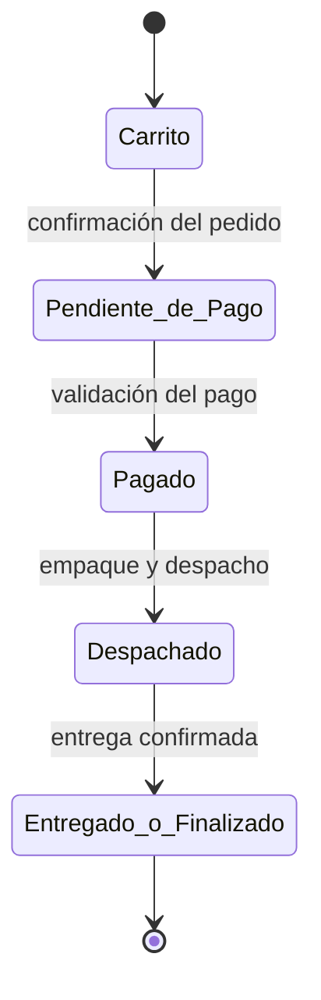
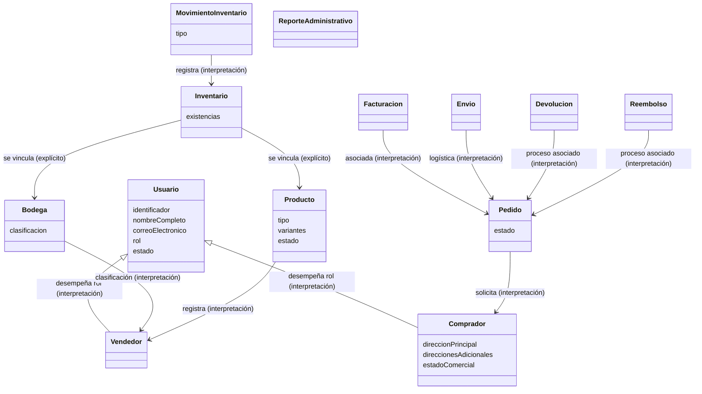

# Modelo de Dominio del Negocio — NexusMarket

**Entregable 1 — Evidencia 1: Modelo de dominio del negocio (10 %)**
Construcción de Software 2 · Tecnológico de Antioquia · 2026-2

- **Estudiante:** Jhon Bayron Peláez Guerra
- **Docente:** Andrés Felipe Sánchez Aguiar
- **Fecha:** 2026-08-25
- **Fuente primaria:** Especificación Funcional del Negocio: NexusMarket

---

## 1. Convenciones del documento

Cada elemento del modelo se clasifica según su respaldo en la fuente:

| Marca | Significado |
|---|---|
| ✅ **Explícito** | Aparece literalmente en la especificación funcional. |
| 🔶 **Interpretación** | Inferencia razonable y necesaria para el modelo; se indica la base. |
| ⏳ **Pendiente** | Aspecto que la fuente no define; **no se inventa**; requiere aclaración. |

Regla general: **no se convierten automáticamente los sustantivos en entidades** ni se definen agregados, objetos de valor, tablas o clases sin análisis (D-005). Los conceptos listados aquí son **candidatos**, no un diseño definitivo de clases.

## 2. Alcance del modelo

Cubre la totalidad del negocio según los **12 objetivos funcionales** de la especificación:

| Código | Objetivo funcional | Dominio |
|---|---|---|
| OBJ-01 | Administrar la información de todos los usuarios del Marketplace | Usuarios |
| OBJ-02 | Gestionar el registro y administración de vendedores | Vendedores |
| OBJ-03 | Administrar compradores registrados | Compradores |
| OBJ-04 | Controlar la información de las bodegas | Bodegas |
| OBJ-05 | Gestionar el catálogo de productos | Catálogo |
| OBJ-06 | Administrar el inventario distribuido | Inventario |
| OBJ-07 | Gestionar el carrito de compras | Carrito |
| OBJ-08 | Controlar el ciclo completo de los pedidos | Pedidos |
| OBJ-09 | Administrar la facturación de las compras | Facturación |
| OBJ-10 | Gestionar los procesos logísticos | Logística / envíos |
| OBJ-11 | Administrar devoluciones y reembolsos | Devoluciones y reembolsos |
| OBJ-12 | Consolidar información administrativa para consulta | Reportes |

## 3. Participantes del negocio

La especificación define **5 participantes**, cada uno con **un único rol** (RG-02) y acceso solo a la información de sus funciones (RG-03):

| Participante | Descripción general (fuente) |
|---|---|
| Comprador | Persona que adquiere productos publicados. |
| Vendedor | Responsable de registrar y administrar sus productos. |
| Operador Logístico | Encargado de la operación física de bodegas y despachos. |
| Administrador | Responsable de la administración de vendedores y bodegas. |
| Supervisor | Perfil de consulta y seguimiento operativo. |

## 4. Conceptos candidatos por dominio

> Los conceptos se organizan por dominio funcional. "Tipo" indica su respaldo en la fuente.

### 4.1 Administración de usuarios (OBJ-01)

| Concepto | Base en la fuente | Tipo |
|---|---|---|
| Usuario | Componente principal: "personas autorizadas para interactuar con el sistema" | ✅ Explícito |
| Rol | Atributo del usuario; "único por usuario" (RG-02); los 5 participantes son los roles | ✅ Explícito |
| Estado del usuario | Atributo: "condición operativa (Activo, Bloqueado, etc.)" — catálogo exacto no definido | ✅ Explícito (catálogo ⏳ pendiente) |
| Documento de identidad | Validación crítica: "documento de identidad … único" | 🔶 Implícito vía validación; atributo no listado en la tabla |

**Atributos explícitos del usuario:**

| Atributo | Obligatorio | Restricción |
|---|---|---|
| Identificador | Sí | Único |
| Nombre completo | Sí | No vacío |
| Correo electrónico | Sí | Único |
| Rol | Sí | Único por usuario |
| Estado | Sí | Catálogo definido (Activo, Bloqueado, etc.) |

### 4.2 Compradores (OBJ-03)

| Concepto | Base en la fuente | Tipo |
|---|---|---|
| Comprador | Participante; "usuario que realiza compras" | ✅ Explícito |

**Atributos explícitos:**

| Atributo | Obligatorio | Nota |
|---|---|---|
| Dirección principal | Sí | Ubicación habitual para entregas |
| Direcciones adicionales | No | Ubicaciones secundarias de entrega |
| Estado comercial | Sí | Condición del comprador para realizar compras |

**Restricción clave (fuente):** el comprador nunca administra información de otros compradores ni inventarios.

### 4.3 Vendedores (OBJ-02)

| Concepto | Base en la fuente | Tipo |
|---|---|---|
| Vendedor | Participante; "responsable de registrar y administrar sus productos" | ✅ Explícito |

**Regla de negocio (fuente):** los vendedores **no se auto-registran**; son incorporados por el **Administrador**.

### 4.4 Bodegas (OBJ-04)

| Concepto | Base en la fuente | Tipo |
|---|---|---|
| Bodega | Componente: "lugares donde se administra el inventario físico" | ✅ Explícito |
| Clasificación de bodega | "Bodegas del Marketplace" y "bodegas de Vendedores" | ✅ Explícito |

### 4.5 Catálogo (OBJ-05)

| Concepto | Base en la fuente | Tipo |
|---|---|---|
| Producto | Componente: "bienes físicos o digitales ofrecidos" | ✅ Explícito |
| Tipo de producto | "Físico o Digital" (selección) | ✅ Explícito |
| Variante de producto | "Diferencias de color, talla, modelo, etc." (lista) | ✅ Explícito como atributo; su naturaleza (¿atributo o concepto propio?) ⏳ pendiente |
| Estado del producto | Publicado, Suspendido o Descontinuado (selección) | ✅ Explícito |

**Atributos explícitos del producto:**

| Atributo | Tipo de dato (fuente) | Notas |
|---|---|---|
| Tipo de producto | Selección | Físico / Digital |
| Variantes | Lista | Color, talla, modelo, etc. |
| Estado | Selección | Publicado, Suspendido, Descontinuado |

> ⏳ Otros atributos típicos de un producto (nombre, precio, descripción…) **no aparecen en la especificación**; no se inventan.

### 4.6 Inventario (OBJ-06)

| Concepto | Base en la fuente | Tipo |
|---|---|---|
| Inventario | Componente; **distribuido** | ✅ Explícito |
| Movimiento de inventario | "Ingreso, Reserva, Salida por venta, Ajuste y Devolución" | ✅ Explícito como operaciones; ¿entidad con historial u operación? ⏳ pendiente |
| Estado de existencias "Dañado" | Validación crítica: no reservar inventario "marcado como Dañado" | 🔶 Implícito; representación ⏳ pendiente |

**Reglas explícitas:**
- El inventario se vincula **obligatoriamente a un producto y una bodega**.
- **Nunca** se permiten existencias negativas.

### 4.7 Carrito y Pedidos (OBJ-07, OBJ-08)

| Concepto | Base en la fuente | Tipo |
|---|---|---|
| Carrito | Estado inicial del pedido: "selección provisional de productos" (OBJ-07) | ✅ Explícito |
| Pedido | Componente: "solicitudes de compra realizadas por compradores"; "compromiso comercial formal" | ✅ Explícito |
| Estados del pedido | Ciclo: Carrito → Pendiente de Pago → Pagado → Despachado → Entregado/Finalizado | ✅ Explícito |

**Ciclo de estados del pedido (fuente):**

> La especificación **no define transiciones adicionales**; no se inventan.

### 4.8 Facturación (OBJ-09)

| Concepto | Base en la fuente | Tipo |
|---|---|---|
| Facturación | Componente: "información comercial asociada a las ventas" | ✅ Explícito |
| Factura | Entidad derivada de la facturación | 🔶 Interpretación; atributos ⏳ pendientes (la fuente no los detalla) |

### 4.9 Logística / envíos (OBJ-10)

| Concepto | Base en la fuente | Tipo |
|---|---|---|
| Envío | Componente: "procesos logísticos para productos físicos" | ✅ Explícito |
| Procesos logísticos | Flujo: empaque, despacho y transporte; el pedido finaliza tras entrega confirmada | ✅ Explícito |

### 4.10 Devoluciones y reembolsos (OBJ-11)

| Concepto | Base en la fuente | Tipo |
|---|---|---|
| Devolución | Proceso incluido; también es un tipo de movimiento de inventario | ✅ Explícito |
| Reembolso | Proceso incluido; gestión a cargo de Comprador y Administrador (matriz) | ✅ Explícito |

### 4.11 Reportes administrativos (OBJ-12)

| Concepto | Base en la fuente | Tipo |
|---|---|---|
| Reporte administrativo | "Consolidar información administrativa para consulta"; perfil Supervisor (consulta y seguimiento) | ✅ Explícito; contenido y alcance de los reportes ⏳ pendientes |

## 5. Relaciones candidatas

| Relación | Base en la fuente | Tipo |
|---|---|---|
| Inventario → Producto | "vinculado obligatoriamente a un producto y una bodega" | ✅ Explícita |
| Inventario → Bodega | Ídem | ✅ Explícita |
| Producto → Vendedor | Matriz: registro de productos = Vendedor; "registrar y administrar sus productos" | 🔶 Interpretación razonable (pertenencia vendedor–producto) |
| Producto → Variantes | Atributo "variantes" | 🔶 Interpretación |
| Comprador → Pedido | "solicitudes de compra realizadas por compradores" | 🔶 Interpretación razonable |
| Pedido → Facturación | "información comercial asociada a las ventas" | 🔶 Interpretación |
| Pedido → Envío | envíos = procesos logísticos para productos físicos | 🔶 Interpretación |
| Pedido → Devolución/Reembolso | procesos incluidos; devolución como movimiento | 🔶 Interpretación |
| Pedido → Producto(s) | contenido del pedido | ⏳ Pendiente (la fuente no describe ítems de pedido) |
| Bodega → Vendedor | clasificación "bodegas de Vendedores" | 🔶 Interpretación |
| Usuario → Rol | "rol … único por usuario"; participantes | ✅ Explícita |
| Participante → Usuario | "cada participante desempeña un único rol" | 🔶 Interpretación razonable |

## 6. Comportamientos y responsabilidades (matriz explícita)

| Proceso | Comprador | Vendedor | Op. Logístico | Administrador |
|---|---|---|---|---|
| Registro de vendedores | — | — | — | ✅ |
| Registro de productos | — | ✅ | — | — |
| Administración de inventario | — | ✅ | ✅ | — |
| Gestión de pedidos | ✅ | ✅ | ✅ | — |
| Gestión de reembolsos | ✅ | — | — | ✅ |

**Flujo general del negocio (fuente):**

1. **Incorporación:** el Administrador registra al vendedor y su primera bodega.
2. **Catálogo:** el vendedor registra productos y define sus características.
3. **Inventario:** se registran existencias iniciales en las bodegas asociadas.
4. **Publicación:** los productos se hacen visibles en el catálogo público.
5. **Compra:** el comprador selecciona productos mediante el carrito y confirma el pedido.
6. **Transacción:** se valida el pago y se inicia el flujo de preparación.
7. **Logística:** empaque, despacho y transporte del pedido.
8. **Cierre:** el pedido se marca como finalizado tras la entrega confirmada.

## 7. Restricciones generales (RG)

| Código | Restricción |
|---|---|
| RG-01 | Toda operación debe ejecutarse por un usuario autenticado. |
| RG-02 | Cada usuario tendrá un único rol dentro del sistema. |
| RG-03 | Ningún participante podrá administrar información fuera de su rol. |

## 8. Validaciones críticas (fuente)

1. **Inventario:** no se puede reservar inventario **inexistente**.
2. **Inventario:** no se puede reservar inventario marcado como **"Dañado"**.
3. **Pedidos:** un pedido **finalizado** no podrá ser modificado bajo ninguna circunstancia.
4. **Usuarios:** el **documento de identidad** debe ser único.
5. **Usuarios:** el **correo electrónico** debe ser único.

## 9. Reglas de negocio consolidadas

| # | Regla | Fuente |
|---|---|---|
| RN-01 | Toda operación requiere usuario autenticado. | RG-01 |
| RN-02 | Cada usuario tiene un único rol. | RG-02 |
| RN-03 | Ningún participante administra información fuera de su rol. | RG-03 |
| RN-04 | Los vendedores no se auto-registran; los incorpora el Administrador. | Dominio 3 |
| RN-05 | El comprador no administra otros compradores ni inventarios. | Dominio 2 |
| RN-06 | Un producto es físico o digital. | Dominio 5 |
| RN-07 | El producto físico requiere inventario y despacho. | Dominio 5 |
| RN-08 | El producto digital se entrega inmediatamente después del pago. | Dominio 5 |
| RN-09 | El inventario es distribuido y se vincula a un producto y una bodega. | Dominio 6 |
| RN-10 | Las existencias nunca son negativas. | Dominio 6 |
| RN-11 | No se reserva inventario inexistente. | Validaciones |
| RN-12 | No se reserva inventario marcado como Dañado. | Validaciones |
| RN-13 | Un pedido finalizado no se modifica. | Validaciones |
| RN-14 | Documento de identidad único. | Validaciones |
| RN-15 | Correo electrónico único. | Validaciones |
| RN-16 | El pedido sigue el ciclo Carrito → Pendiente de Pago → Pagado → Despachado → Entregado/Finalizado, sin transiciones adicionales. | Dominio 7 |

## 10. Diagrama conceptual del dominio

> Diagrama **preliminar de conceptos** (no diseño definitivo de clases). Línea continua = relación explícita en la fuente; línea punteada = interpretación razonable.

## 11. Pendientes / preguntas abiertas

1. ¿Las **variantes** son un atributo del producto o un concepto con identidad propia?
2. ¿Qué atributos tiene un producto además de tipo, variantes y estado (nombre, precio, descripción…)? La especificación no los menciona → no se inventan.
3. ¿Los **movimientos de inventario** son un historial (entidad) o solo operaciones sobre existencias?
4. ¿Cómo se representa el estado **"Dañado"** (por unidad, lote, o existencias de bodega)?
5. ¿Qué atributos tiene la **facturación**? La fuente solo dice "información comercial asociada a las ventas".
6. ¿El **contenido del pedido** (ítems, cantidades, precios) queda definido en otra fuente o lo confirmamos con el docente?
7. ¿Cuál es el **catálogo exacto de estados del usuario** ("Activo, Bloqueado, etc.") y del **estado comercial** del comprador?
8. ¿Qué **reportes administrativos** concretos se esperan (OBJ-12)?
9. ¿El inventario distribuido implica **consultar existencias por bodega**? (interpretación probable: sí).

## 12. Trazabilidad del modelo

| Requisito | Fuente | Cubierto en |
|---|---|---|
| OBJ-01 | Especificación | § 4.1, § 7, § 8, RN-02/03/14/15 |
| OBJ-02 | Especificación | § 4.3, § 6, RN-04 |
| OBJ-03 | Especificación | § 4.2, RN-05 |
| OBJ-04 | Especificación | § 4.4, § 5, § 6 (flujo paso 1) |
| OBJ-05 | Especificación | § 4.5, RN-06/07/08 |
| OBJ-06 | Especificación | § 4.6, § 5, RN-09/10/11/12 |
| OBJ-07 | Especificación | § 4.7, flujo paso 5 |
| OBJ-08 | Especificación | § 4.7, RN-13/16, flujo pasos 5–8 |
| OBJ-09 | Especificación | § 4.8 |
| OBJ-10 | Especificación | § 4.9, flujo paso 7 |
| OBJ-11 | Especificación | § 4.10, § 6 (matriz reembolsos) |
| OBJ-12 | Especificación | § 4.11 |
| RG-01 | Especificación | § 7, RN-01 |
| RG-02 | Especificación | § 7, RN-02 |
| RG-03 | Especificación | § 7, RN-03 |
| Validaciones críticas | Especificación | § 8, RN-11 a RN-15 |
| Matriz de responsabilidades | Especificación | § 6 |

---

*Documento elaborado a partir de la Especificación Funcional del Negocio: NexusMarket. Los elementos marcados como interpretación o pendiente no constituyen diseño definitivo; se resolverán con el análisis de los siguientes entregables o con aclaración del docente.*
